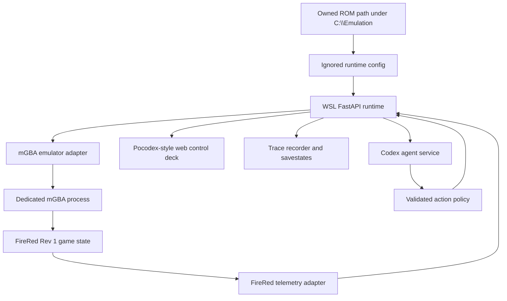

# Project Roadmap

`PLAN.md` is the project-level roadmap and status index. Keep implementation
detail in `.vault/plans/`.

## Current State

- The workspace at `/home/gilgames/Code/pokemon-disassembly-and-play` has been bootstrapped from `pret/pokefirered` and initialized as a git repository on `main`.
- The project will build a Windows-friendly programmable runtime inspired by `Dimillian/Pocodex`, but based on `pret/pokefirered` and the user's owned FireRed/LeafGreen Rev 1 ROMs.
- The committed first implementation path is FireRed Rev 1, a separate dedicated runtime emulator instance, mGBA as the first bridge target, and BizHawk as the fallback.
- Real Windows mGBA bridge proof is complete using the official dev build, Lua-client reverse socket mode, WSLENV exports, Windows-local script/screenshot staging, and real-time frame waits.
- Plan 003 is complete: the static web control deck has a tested API client, hold-capable manual controls, telemetry/trace summaries, runtime-owned savestate controls, and desktop/mobile browser verification against a fake runtime. Real runtime decoded state still needs generated `pokefirered_rev1.sym`.
- Plan 004 is complete at fake-runtime/API/browser level: context, action policy, planner service, bounded objective runner, HTTP endpoints, and web control-deck agent state are implemented. Real mGBA objective smoke remains an environment check.
- Plan 005 is in progress: FireRed/LeafGreen Rev 1 profiles, hash checks, LeafGreen adapter path, target-scoped runtime storage, and the evidence-based BizHawk fallback decision are complete.
- Plan 001 is complete: the runtime can launch real mGBA, serve the basic deck, capture snapshots, accept validated actions, record traces, and expose minimal FireRed telemetry.
- Active goal overlay: `.vault/goals/goal-firered-runtime-2026-06-04/`.

## Active Plans

| Feature Plan | Feature | Status | Next Action |
|---|---|---|---|
| `.vault/plans/001-firered-runtime-spike-2026-06-04.md` | Bootstrap the `pret/pokefirered` workspace and prove mGBA launch, screenshot, input, and minimal telemetry. | Complete | Preserve as baseline; continue with plan 002. |
| `.vault/plans/002-firered-telemetry-adapter-2026-06-04.md` | Expand FireRed symbol, save block, map, text, mode, party, bag, and event telemetry. | Complete | Preserve as telemetry baseline; runtime symbol-generation smoke remains a later environment task. |
| `.vault/plans/003-runtime-web-control-deck-2026-06-04.md` | Build the Pocodex-style browser control deck, trace UX, manual controls, and save-state surfaces. | Complete | Preserve as manual operation baseline; continue with plan 004. |
| `.vault/plans/004-codex-agent-loop-2026-06-04.md` | Add planner-safe Codex agent integration, `agent_context`, action policy, and objective loop. | Complete | Preserve as agent-loop baseline; real mGBA objective smoke remains a later environment check. |
| `.vault/plans/005-leafgreen-support-and-hardening-2026-06-04.md` | Add LeafGreen Rev 1 support, fallback bridge checks, packaging/docs, and regression hardening. | In Progress | Execute M5.T5: write setup and operating docs. |

## Active Goal Runs

Use this section only when native `/goal` or `$lfg` is coordinating work across
time or across multiple feature plans.

| Goal Run | Coordinates | Status | Next Action |
|---|---|---|---|
| `.vault/goals/goal-firered-runtime-2026-06-04/` | Plans 001 through 005 | Active | Continue M5.T5 from `task-graph.md` and `handoff.md`. |

## Primary Goals

1. Build a local programmable runtime that can launch, observe, control, and instrument Pokemon FireRed Rev 1 from the user's owned ROM.
2. Preserve a Pocodex-like architecture: HTTP runtime API, browser control deck, action traces, telemetry, and Codex agent loop.
3. Keep emulator, game telemetry, UI, and agent layers modular so LeafGreen and alternate emulator bridges can be added without rewriting the runtime.

## Success Criteria

- [x] The workspace is bootstrapped from `pret/pokefirered` without committing ROMs or user emulator saves.
- [x] A dedicated mGBA runtime instance can launch FireRed Rev 1 from ignored local configuration.
- [x] `/health`, `/snapshot`, `/telemetry`, `/action`, and `/agent_context` exist with tests around public behavior.
- [x] The web UI shows a live frame, manual controls, current telemetry, savestates, and traces.
- [x] The web UI shows agent state after plan 004 adds agent context and runner endpoints.
- [x] The runtime decodes FireRed map/player/mode and core inventory/party/event state from symbols or documented offsets.
- [x] The Codex agent loop can observe, choose validated actions, execute them, and verify results without uncontrolled inputs.
- [ ] LeafGreen Rev 1 can be configured and smoke-tested after FireRed stabilizes.

## Architecture Snapshot



ASCII fallback:

```text
Owned ROM path -> ignored config -> WSL FastAPI runtime -> mGBA adapter -> dedicated mGBA
                                  -> FireRed telemetry -> web UI / traces / Codex agent
```

## Decision Index

| Decision | Rationale | Date | Link |
|:---------|:----------|:-----|:-----|
| Dedicated runtime emulator instance | Protect real play sessions and make automation reproducible. | 2026-06-03 | `.vault/decisions/dedicated-runtime-emulator-instance-2026-06-03.md` |
| mGBA first runtime bridge | Direct GBA fit with Lua memory/input/savestate primitives; BizHawk remains fallback. | 2026-06-04 | `.vault/decisions/mgba-first-runtime-bridge-2026-06-04.md` |
| First-spike scope boundaries | Resolve open planning choices before goal execution begins. | 2026-06-04 | `.vault/decisions/first-spike-scope-boundaries-2026-06-04.md` |
| Agent action policy boundaries | Planner actions use advertised IDs with fixed affordances and traced rejections. | 2026-06-04 | `.vault/decisions/agent-action-policy-boundaries-2026-06-04.md` |
| Agent client disabled by default | Manual runtime does not require Codex credentials; fake/app-server clients are opt-in. | 2026-06-04 | `.vault/decisions/agent-client-disabled-default-2026-06-04.md` |
| Target profile hash verification | FireRed/LeafGreen profiles verify expected ROM SHA-1 by default. | 2026-06-04 | `.vault/decisions/target-profile-hash-verification-2026-06-04.md` |
| BizHawk fallback not needed yet | mGBA bridge issues have been resolved and current evidence does not justify a second adapter. | 2026-06-04 | `.vault/decisions/bizhawk-fallback-not-needed-2026-06-04.md` |

## Risk Register

| Risk | Impact | Likelihood | Mitigation | Owner |
|:-----|:-------|:-----------|:-----------|:------|
| mGBA launch or Lua/socket IPC from WSL/Windows is awkward. | Medium | Low | Proven path uses dev mGBA, Lua-client reverse socket mode, WSLENV exports, staged Windows paths, and real-time frame waits; keep BizHawk fallback only for new evidence. | implementer |
| `pret/pokefirered` build toolchain is missing or slow to configure. | Medium | Medium | Use existing reference clone for source evidence, verify owned ROM hash first, and document build blockers in `.vault/encounters/`. | implementer |
| FireRed state decoding is more pointer/encryption dependent than expected. | High | Medium | Keep plan 001 telemetry narrow, then use plan 002 for symbol and save-block validation. | implementer |
| Agent loop sends unsafe or noisy inputs. | High | Medium | Gate plan 004 behind validated action policy, cooldowns, trace review, and deterministic savestates. | reviewer/security |
| ROMs or saves accidentally enter git. | High | Low | Use ignored local config and explicit plan checks before committing or packaging. | security |

## Knowledge Index

- Research: `.vault/research/pocodex-pokefirered-runtime-2026-06-03.md`
- Decisions: `.vault/decisions/`
- Solutions: `.vault/solutions/`
- Encounters: `.vault/encounters/`
- Goal run: `.vault/goals/goal-firered-runtime-2026-06-04/`
- Visual companions: `.vault/visuals/`

## Maintenance Notes

- Update this file when a feature plan is created, completed, paused, or replaced.
- Promote durable choices into `.vault/decisions/`.
- Capture reusable fixes in `.vault/solutions/` and recurring blockers in `.vault/encounters/`.
- During native `/goal` execution, update `.vault/goals/goal-firered-runtime-2026-06-04/progress.md` after each meaningful implementation or validation step.
