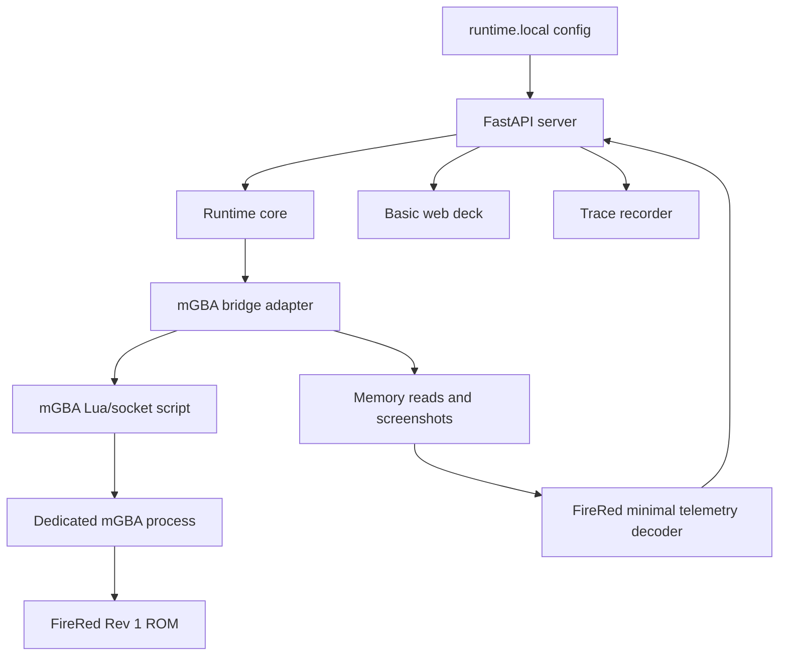

# FireRed Runtime Spike

## Goal

- Bootstrap this empty workspace from `pret/pokefirered`.
- Prove a dedicated mGBA-backed runtime loop for FireRed Rev 1.
- Expose the smallest useful Pocodex-like surface: launch, health, snapshot, input action, minimal telemetry, traces, and an initial browser control deck.

## Starting Point

- Current behavior:
  - The workspace contains `.vault` only and is not a git repository.
  - Reference clones exist at `/home/gilgames/Code/github-clones/Dimillian-Pocodex` and `/home/gilgames/Code/github-clones/pret-pokefirered`.
  - The user's FireRed Rev 1 ROM has already been verified against `pret/pokefirered`'s target SHA-1 in the research note.
- Current files/docs to read first:
  - `.vault/PLAN.md`
  - `.vault/research/pocodex-pokefirered-runtime-2026-06-03.md`
  - `.vault/decisions/dedicated-runtime-emulator-instance-2026-06-03.md`
  - `.vault/decisions/mgba-first-runtime-bridge-2026-06-04.md`
  - `.vault/decisions/first-spike-scope-boundaries-2026-06-04.md`
  - `/home/gilgames/Code/github-clones/Dimillian-Pocodex/tools/runtime/README.md`
  - `/home/gilgames/Code/github-clones/Dimillian-Pocodex/tools/runtime/runtime_core.py`
  - `/home/gilgames/Code/github-clones/Dimillian-Pocodex/tools/runtime/server.py`
  - `/home/gilgames/Code/github-clones/Dimillian-Pocodex/tools/runtime/static/app.js`
  - `/home/gilgames/Code/github-clones/pret-pokefirered/README.md`
  - `/home/gilgames/Code/github-clones/pret-pokefirered/INSTALL.md`
  - `/home/gilgames/Code/github-clones/pret-pokefirered/Makefile`
  - `/home/gilgames/Code/github-clones/pret-pokefirered/include/global.h`

## Non-Goals and Boundaries

- Do not commit or copy ROM files into git.
- Do not attach to or control the user's active Mesen2 play sessions.
- Do not implement LeafGreen in this plan.
- Do not implement rich party, bag, battle, dialogue, or objective state in this plan.
- Do not activate autonomous Codex gameplay in this plan.
- Ask before destructive git operations, deleting local files, installing system-wide dependencies, or changing files outside the workspace and `/tmp`.

## Related Artifacts

- Research:
  - [x] `.vault/research/pocodex-pokefirered-runtime-2026-06-03.md`
- Decisions:
  - [x] `.vault/decisions/dedicated-runtime-emulator-instance-2026-06-03.md`
  - [x] `.vault/decisions/mgba-first-runtime-bridge-2026-06-04.md`
  - [x] `.vault/decisions/first-spike-scope-boundaries-2026-06-04.md`
- Solutions:
  - [ ] `.vault/solutions/firered-runtime-spike-solution-2026-06-04.md`
- Encounters:
  - [ ] `.vault/encounters/firered-runtime-spike-encounter-2026-06-04.md`
- Visual companion:
  - [ ] Not needed for this plan; Mermaid diagrams are sufficient.
- Goal run:
  - [x] `.vault/goals/goal-firered-runtime-2026-06-04/`

## Success Criteria

- [ ] The workspace contains `pret/pokefirered` source plus `.vault`, with ROMs and runtime-local artifacts ignored.
- [ ] FireRed Rev 1 ROM path is configured through an ignored local config or environment variable.
- [ ] A dedicated visible mGBA instance can launch FireRed Rev 1 from the runtime.
- [ ] Runtime can capture a frame or screenshot for `/snapshot`.
- [ ] Runtime can press and release at least one button through `/action` and observe frame/state progression.
- [ ] Runtime can read enough memory to expose frame count, ROM identity/hash, `gSaveBlock1Ptr`, `gSaveBlock2Ptr`, map group/number, and player/camera coordinates when available.
- [ ] `/health`, `/snapshot`, `/telemetry`, `/action`, and basic static UI routes exist.
- [ ] Focused tests cover config validation, action validation, emulator interface behavior through a fake bridge, and FireRed minimal telemetry decoding from fixture bytes.

## Architecture Diagram



ASCII fallback:

```text
ignored config -> FastAPI runtime -> mGBA adapter -> mGBA Lua/socket -> FireRed
                                      -> screenshot/input/memory -> telemetry/API/UI
```

## ADR Summary

- Decision: Use a dedicated visible mGBA-backed runtime instance for the first spike.
- Drivers:
  - Protect real saves and Mesen2 play sessions.
  - Validate emulator bridge behavior before building higher-level telemetry or agents.
  - Keep bridge and FireRed decoding behind replaceable adapters.
- Alternatives considered:
  - Mesen2-first: not chosen because dedicated runtime removes its main advantage.
  - BizHawk-first: kept as fallback, but not first because mGBA is the direct GBA fit.
  - Headless-first: deferred because visible emulator state is easier to debug.
- Consequences:
  - Plan 001 must include workspace bootstrap, runtime-local config, and ignored artifacts.
  - Later plans can build on stable API/adapter boundaries.
- Promote to `.vault/decisions/`: Already promoted.

## Worktree Session

- Required: No for the initial bootstrap because this workspace is not a git repository yet.
- Recommended command: After the workspace is initialized as a git repo, create normal branches or worktrees for later plans.
- Expected worktree name: `firered-runtime-spike`
- Branch plan: Initialize the source tree first, then use a branch such as `feat/firered-runtime-spike` if committing.
- Review note: Before any commit, review `git status --short` and confirm no ROMs, saves, screenshots, or local config are staged.

## Execution Steps

- [x] Step 1: Bootstrap the source tree.
  - ACTION: Populate the current workspace from `pret/pokefirered` while preserving `.vault`.
  - IMPLEMENT: Prefer upstream fetch/checkout if network is available; otherwise use the local reference clone as a fallback source. Preserve source layout and do not import ROMs.
  - FILES: root source files from `pret/pokefirered`, `.gitignore`
  - MIRROR: `/home/gilgames/Code/github-clones/pret-pokefirered`
  - GOTCHA: `git clone .` will fail because `.vault` already exists; use a controlled bootstrap that keeps `.vault`.
  - VALIDATE: `test -f Makefile`, `test -f include/global.h`, and `find . -name '*.gba' -print` returns no tracked workspace ROMs.

- [x] Step 2: Establish runtime-local configuration and ignores.
  - ACTION: Add sample config and ignore rules for ROM paths, runtime states, logs, traces, screenshots, and mGBA local artifacts.
  - IMPLEMENT: Use a committed example such as `tools/runtime/runtime.example.toml`; keep `runtime.local.toml` ignored.
  - FILES: `.gitignore`, `tools/runtime/runtime.example.toml`, `tools/runtime/README.md`
  - MIRROR: Pocodex runtime launcher docs, but adapt paths for Windows/WSL.
  - GOTCHA: Never commit the actual `C:\Emulation` ROM path if it exposes private local layout beyond the example.
  - VALIDATE: Config loader rejects missing ROM path and accepts a test fixture path.

- [x] Step 3: Create the Python runtime skeleton.
  - ACTION: Add a small FastAPI runtime package with app creation, runtime core, action validation, trace recorder, and adapter interfaces.
  - IMPLEMENT: Keep `runtime_core` emulator-agnostic; place mGBA specifics under `tools/runtime/emulators/`.
  - FILES: `tools/runtime/server.py`, `tools/runtime/runtime_app.py`, `tools/runtime/runtime_core.py`, `tools/runtime/action_executor.py`, `tools/runtime/trace_recorder.py`, `tools/runtime/emulators/base.py`
  - MIRROR: `/home/gilgames/Code/github-clones/Dimillian-Pocodex/tools/runtime/`
  - GOTCHA: Do not copy Game Boy-specific PyBoy or `w*` symbol logic.
  - VALIDATE: `pytest -q tools/runtime/tests`

- [ ] Step 4: Implement the mGBA bridge spike.
  - ACTION: Add an mGBA adapter and Lua/socket script that can launch, report health, send button input, capture a screenshot/frame, and read memory.
  - IMPLEMENT: Keep protocol tiny: `ping`, `frame`, `screenshot`, `press`, `release`, `read8`, `read16`, `read32`, `save_state`, `load_state` if available.
  - FILES: `tools/runtime/emulators/mgba_bridge.py`, `tools/runtime/emulators/mgba_bridge.lua`
  - MIRROR: mGBA Lua API concepts documented in the research note.
  - GOTCHA: If mGBA launch or socket IPC blocks progress, capture an encounter and switch to BizHawk only after preserving the adapter boundary.
  - VALIDATE: Fake bridge tests pass; manual smoke can launch a visible mGBA instance.

- [ ] Step 5: Add minimal FireRed Rev 1 telemetry.
  - ACTION: Decode ROM identity, raw pointer symbols, map/location, and player/camera coordinates from mGBA memory reads.
  - IMPLEMENT: Use symbol output if available; otherwise document any fixed addresses/offsets used and validate against `include/global.h`.
  - FILES: `tools/runtime/games/firered/symbols.py`, `tools/runtime/games/firered/save_blocks.py`, `tools/runtime/games/firered/telemetry.py`
  - MIRROR: `include/global.h`, `src/main.c`, `src/fieldmap.c`
  - GOTCHA: Gen 3 save data has pointers and encrypted fields; keep this plan to unencrypted location/position basics.
  - VALIDATE: Fixture tests decode expected little-endian pointer and position values.

- [ ] Step 6: Expose minimal API and browser deck.
  - ACTION: Serve `/health`, `/snapshot`, `/telemetry`, `/action`, and a basic static control page.
  - IMPLEMENT: Use predictable JSON models; button actions must be whitelisted and traced.
  - FILES: `tools/runtime/server.py`, `tools/runtime/static/index.html`, `tools/runtime/static/styles.css`, `tools/runtime/static/app.js`
  - MIRROR: Pocodex static runtime deck.
  - GOTCHA: Keep UI plain and functional; plan 003 owns polish and richer panels.
  - VALIDATE: API smoke tests pass and manual browser check shows a frame/telemetry update after input.

## Code Documentation Contract

- [ ] New nontrivial source files include top-level language-native documentation.
- [ ] Public functions, classes, commands, and modules have concise doc comments where signatures are not self-explanatory.
- [ ] Comments explain intent, invariants, tradeoffs, or edge cases rather than restating code.

## Testing Strategy (TDD)

### TDD Contract

- [ ] Red: write a failing test first for config, action validation, adapter contract, and telemetry decoding behavior where practical.
- [ ] Green: implement the smallest change that passes.
- [ ] Refactor: improve structure while keeping tests green.

### Test File Plan

- New tests to add:
  - `tools/runtime/tests/test_missing_rom_config_should_fail_fast.py`
  - `tools/runtime/tests/test_action_not_allowed_should_be_rejected.py`
  - `tools/runtime/tests/test_fake_emulator_should_capture_snapshot_after_input.py`
  - `tools/runtime/tests/test_firered_saveblock_fixture_should_decode_position.py`
  - `tools/runtime/tests/test_health_endpoint_should_report_runtime_state.py`
- Existing tests to update:
  - None initially.
- Naming convention notes:
  - Use `~/.agents/skills/core/tdd-tester/SKILL.md` conventions where the framework permits: `[condition]-should-[expected-behavior]`.
  - Python test function example: `test_missing_rom_config_should_fail_fast`.

### Coverage Layers

- [x] Unit tests for config/action/telemetry decoding
- [x] Integration tests with fake emulator adapter
- [ ] Manual workflow smoke with real mGBA
- [ ] Browser smoke once static deck exists

## Execution Lanes

- Implementation lane: `implementer`
- Validation lane: `validator`
- Review lane: `reviewer`
- Security lane: `security`
- Pattern lane: `pattern-detector`
- Design lane: `design-iterator` only for obvious UI layout defects
- Accessibility lane: `accessibility-auditor` for the basic web deck labels and keyboard controls

## Goal Run Overlay

- Goal run path: `.vault/goals/goal-firered-runtime-2026-06-04/`
- Role in goal run: Primary
- Milestone/task IDs:
  - `M1.T1` Bootstrap source tree
  - `M1.T2` Runtime config and ignores
  - `M1.T3` Runtime skeleton
  - `M1.T4` mGBA bridge spike
  - `M1.T5` Minimal telemetry
  - `M1.T6` API and basic browser deck
- Dependencies:
  - `M1.T2` depends on `M1.T1`
  - `M1.T3` depends on `M1.T2`
  - `M1.T4` depends on `M1.T3`
  - `M1.T5` depends on `M1.T4`
  - `M1.T6` depends on `M1.T5`
- Current state: ready
- Handoff source: `.vault/goals/goal-firered-runtime-2026-06-04/handoff.md`

## Verification Contract

- Primary commands:
  - `python -m pytest -q tools/runtime/tests`
  - `python -m tools.runtime.server --config tools/runtime/runtime.local.toml`
  - Manual browser smoke against the local runtime URL
- Required proof of completion:
  - Test output showing focused runtime tests pass.
  - Runtime health JSON.
  - Screenshot/frame visible through `/snapshot` or the basic web deck.
  - Trace entry showing a validated button action changed frame/state.
  - Telemetry JSON with ROM identity/hash and minimal FireRed fields.
- Review gates:
  - validator pass
  - reviewer approve
  - security pass for ROM/savestate/config handling
  - pattern-detector pass for adapter boundaries

## Goal Contract

Use this block as the source for Codex native `/goal` when long-running continuation is useful.

```text
Objective:
Complete plan 001 by bootstrapping the workspace from `pret/pokefirered` and proving a dedicated mGBA-backed FireRed Rev 1 runtime spike with health, snapshot, action, minimal telemetry, trace, and basic browser UI surfaces.

Starting point:
The repo currently contains `.vault` only. Active plan: `.vault/plans/001-firered-runtime-spike-2026-06-04.md`. Active goal overlay: `.vault/goals/goal-firered-runtime-2026-06-04/`.

Read first:
- `.vault/PLAN.md`
- `.vault/research/pocodex-pokefirered-runtime-2026-06-03.md`
- `.vault/decisions/dedicated-runtime-emulator-instance-2026-06-03.md`
- `.vault/decisions/mgba-first-runtime-bridge-2026-06-04.md`
- `.vault/decisions/first-spike-scope-boundaries-2026-06-04.md`
- `.vault/goals/goal-firered-runtime-2026-06-04/handoff.md`

Constraints:
- Do not commit ROMs, saves, screenshots, local config, credentials, or emulator state.
- Do not attach to active Mesen2 sessions.
- Keep FireRed-specific decoding out of runtime core.
- Ask before destructive git/filesystem actions, system-wide installs, or expanding to LeafGreen/agent autonomy.

Iteration policy:
- Work in small milestones from the task graph.
- Prefer TDD for config, action validation, adapter contract, and telemetry decoding.
- Run focused verification after each milestone.
- If the same blocker recurs twice, stop and capture an encounter.
- Capture durable decisions, reusable solutions, and recurring encounters as they arise.

Verification:
- `python -m pytest -q tools/runtime/tests`
- Runtime health check
- Manual mGBA launch/snapshot/input/telemetry/browser smoke

Stop conditions:
- Success: plan 001 success criteria pass with final evidence.
- Ask user: destructive action, dependency install requiring approval, or scope expansion.
- Blocker: mGBA launch/IPC prevents progress after two focused attempts.

Final evidence:
- Changed files summary, test output, runtime smoke evidence, open risks, and updated `.vault/goals/goal-firered-runtime-2026-06-04/progress.md`.
```

## Durable Artifact Capture Rule

- Capture `.vault/decisions/firered-runtime-spike-decision-2026-06-04.md` when implementation or review confirms an architecture, data, security, or workflow choice that outlives this plan.
- Capture `.vault/solutions/firered-runtime-spike-solution-2026-06-04.md` when implementation or review produces a reusable fix, convention, or pattern.
- Capture `.vault/encounters/firered-runtime-spike-encounter-2026-06-04.md` when the run hits a surprising blocker, recurring failure, root cause worth remembering, or prevention rule likely to matter later.
- Include this plan path in the artifact frontmatter/content and include the plan topic in the filename.

## Risks and Mitigations

| Risk | Likelihood | Impact | Mitigation |
|------|------------|--------|------------|
| mGBA launch or socket IPC is not straightforward from WSL. | Medium | High | Keep adapter narrow, capture an encounter, and switch to BizHawk if the spike stalls. |
| Toolchain/build setup is incomplete. | Medium | Medium | Make runtime source bootstrap independent from full ROM rebuild; document build blocker separately. |
| Minimal telemetry reads invalid pointers before save initialization. | Medium | Medium | Return explicit unknown/unavailable fields rather than success-shaped defaults. |
| ROM/local config leaks into git. | Low | High | Add ignore rules and run status checks before staging. |

## Open Questions

- [ ] Which exact mGBA executable path should local config use on this machine?
- [ ] Does mGBA Lua/socket launch reliably from WSL, or does the process need to launch through Windows shell integration?

## Progress Log

- 2026-06-04: Plan created from prior brainstorm, research note, and accepted ADRs.
- 2026-06-04: Completed M1.T1 by bootstrapping the workspace from the local `pret/pokefirered` reference clone, preserving `.vault`, initializing git on `main`, and committing the source baseline.
- 2026-06-04: Completed M1.T2 and M1.T3 with ignored runtime-local config, a FastAPI runtime skeleton, emulator bridge contract, fake emulator, action validation, trace recording, and five passing runtime tests.
