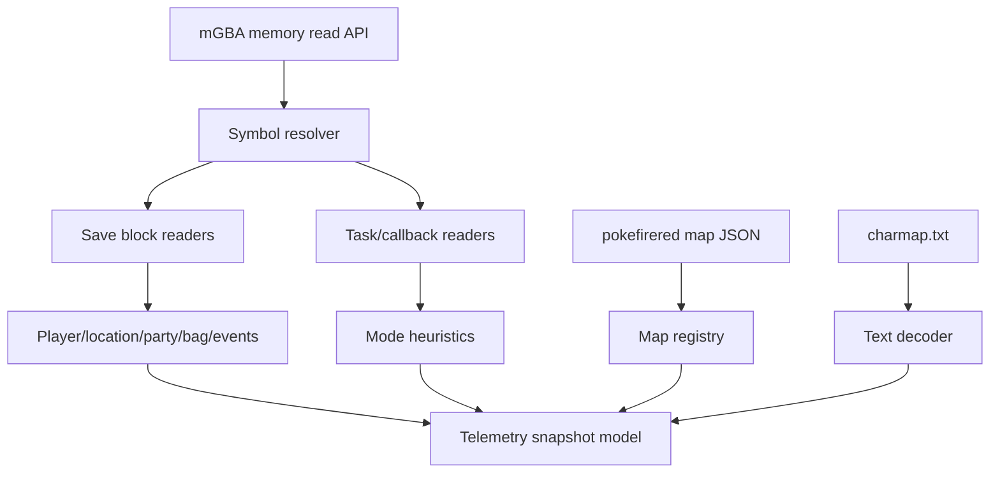

# FireRed Telemetry Adapter

## Goal

- Turn the plan 001 telemetry spike into a reliable FireRed Rev 1 game-state adapter.
- Decode enough state for a human and Codex agent to understand current location, mode, party, bag, money, flags/vars, battle/menu/dialogue hints, and map context.
- Keep all FireRed-specific memory, symbol, save-block, text, and map logic outside the emulator and runtime core layers.

## Starting Point

- Current behavior:
  - Plan 001 should provide an mGBA-backed memory-read surface and minimal pointer/location telemetry.
  - `pret/pokefirered` provides C structs, map JSON, layout data, charmaps, linker symbols, and build outputs that can drive richer decoding.
- Current files/docs to read first:
  - `.vault/plans/001-firered-runtime-spike-2026-06-04.md`
  - `.vault/research/pocodex-pokefirered-runtime-2026-06-03.md`
  - `include/global.h`
  - `src/main.c`
  - `src/event_data.c`
  - `src/fieldmap.c`
  - `data/maps/*/map.json`
  - `data/layouts/*/map.bin`
  - `charmap.txt`
  - build output `pokefirered_rev1.sym` or equivalent symbol file once available

## Non-Goals and Boundaries

- Do not change emulator bridge behavior except where a missing read primitive blocks telemetry.
- Do not implement autonomous gameplay decisions in this plan.
- Do not require LeafGreen compatibility yet, but avoid hard-coded naming that prevents it.
- Do not decode encrypted fields without validating the relevant key and formula from source.

## Related Artifacts

- Research:
  - [x] `.vault/research/pocodex-pokefirered-runtime-2026-06-03.md`
- Decisions:
  - [x] `.vault/decisions/first-spike-scope-boundaries-2026-06-04.md`
- Solutions:
  - [x] `.vault/solutions/firered-symbol-resolution-2026-06-04.md`
- Encounters:
  - [x] `.vault/encounters/runtime-fastapi-starlette-compatibility-2026-06-04.md`
- Visual companion:
  - [ ] Not needed initially.
- Goal run:
  - [x] `.vault/goals/goal-firered-runtime-2026-06-04/`

## Success Criteria

- [x] Symbol loading resolves and reports coverage for the first required symbol set; callback/task and current-map symbols are represented in the core coverage list for later readers.
- [x] SaveBlock1 and SaveBlock2 readers decode player identity basics, location, position, money, party count, party summary, bag pocket counts, flags, and vars where source evidence supports it.
- [x] Map registry loads map JSON and exposes map name, dimensions, connections, warp/events metadata, and layout references.
- [x] Text decoding handles FireRed character encoding for strings used in telemetry.
- [x] Runtime telemetry distinguishes at least field, battle, menu, dialogue/textbox, transition/loading, and unknown modes using evidence-backed heuristics.
- [x] Tests cover fixture-based decoding and unavailable/invalid pointer cases without broad silent fallbacks.

## Architecture Diagram



ASCII fallback:

```text
memory + symbols -> save blocks/tasks -> telemetry model
map JSON + charmap -> map/text context -> telemetry model
```

## ADR Summary

- Decision: FireRed owns state decoding in `tools/runtime/games/firered/`.
- Drivers:
  - Gen 3 state is pointer and struct based.
  - Emulator bridges should expose primitives, not Pokemon semantics.
  - Agent context depends on stable state contracts.
- Alternatives considered:
  - Inline telemetry in runtime core: rejected because it would block LeafGreen and alternate games.
  - Decode everything from hard-coded addresses: rejected unless symbol export is unavailable and documented.
- Consequences:
  - This plan may need source-derived constants and fixtures.
  - Documentation must cite source structs or symbol evidence for non-obvious offsets.
- Promote to `.vault/decisions/`: Capture if symbol strategy or struct extraction method becomes durable.

## Worktree Session

- Required: Yes after the workspace is a git repo.
- Recommended command: `bash ~/.agents/skills/core/git-worktree/scripts/worktree-manager.sh create firered-telemetry-adapter --from <ref>`
- Expected worktree name: `firered-telemetry-adapter`
- Branch plan: `feat/firered-telemetry-adapter`
- Review note: Review generated constants carefully and confirm they match source evidence.

## Execution Steps

- [x] Step 1: Stabilize symbol resolution.
  - ACTION: Parse build-generated `.sym` or `.map` output and expose address lookup by symbol name.
  - IMPLEMENT: Keep parser tolerant of expected objdump/map formats but explicit on missing symbols.
  - FILES: `tools/runtime/games/firered/symbols.py`, `tools/runtime/tests/test_missing_symbol_should_report_unavailable.py`
  - MIRROR: Pocodex `symbols.py`, adjusted for GBA build output.
  - GOTCHA: Checked-in `sym_*.txt` files are linker layout inputs, not complete runtime symbol outputs.
  - VALIDATE: Symbol fixture tests; `timeout 60s /tmp/pokemon-runtime-venv/bin/python -m pytest -q tools/runtime/tests` -> `21 passed, 7 skipped` in the current sandbox.
  - EVIDENCE: Added `.sym`/linker-map parsing, default `pokefirered_rev1.sym` discovery, symbol coverage reporting, factory auto-discovery, and explicit missing-symbol telemetry.

- [x] Step 2: Build source-backed struct readers.
  - ACTION: Implement readers for SaveBlock1, SaveBlock2, Pokemon party summaries, bag pockets, flags, and vars.
  - IMPLEMENT: Start with documented constants from `include/global.h`; add generation only if manual constants become unmaintainable.
  - FILES: `tools/runtime/games/firered/save_blocks.py`, `tools/runtime/games/firered/party.py`, `tools/runtime/games/firered/items.py`
  - MIRROR: `include/global.h`, `src/event_data.c`
  - GOTCHA: Validate encrypted fields before exposing decoded values.
  - VALIDATE: Fixture byte tests for each reader.
  - EVIDENCE: Added `read_save_block_summary()` for player identity bytes, play time, encrypted money, coins, bag pocket slot/quantity counts, compact flag/var summaries, and checksum-validated party member summaries for species, held item, level, HP, status, personality, OT id, and nickname bytes.

- [x] Step 3: Load map and layout metadata.
  - ACTION: Load `data/maps/*/map.json` and layout references into a queryable registry.
  - IMPLEMENT: Expose map id, name, dimensions, connections, object events, warps, and coordinate context.
  - FILES: `tools/runtime/games/firered/map_data.py`
  - MIRROR: `data/maps`, `data/layouts`
  - GOTCHA: Runtime map group/number must map cleanly to source map constants.
  - VALIDATE: Fixture tests for Pallet Town or starting map metadata.
  - EVIDENCE: Added `tools/runtime/games/firered/map_data.py`, source-backed group/number indexing from `data/maps/map_groups.json`, layout metadata loading, coordinate event context, telemetry location map context, and map registry tests.

- [x] Step 4: Add text and mode heuristics.
  - ACTION: Decode FireRed strings and classify runtime mode from callbacks/tasks/window/text state.
  - IMPLEMENT: Return explicit confidence and evidence fields when mode is heuristic.
  - FILES: `tools/runtime/games/firered/text.py`, `tools/runtime/games/firered/mode.py`
  - MIRROR: `charmap.txt`, relevant UI/task source files.
  - GOTCHA: Do not overclaim dialogue/menu text until screen/text buffers are proven.
  - VALIDATE: Tests for known charmap sequences and mode fixtures.
  - EVIDENCE: Added English `charmap.txt` parsing, greedy multibyte token decode, decoded player/party names in telemetry, and source-backed mode classification from `gPaletteFade.active`, `gMain.inBattle`, `gMain.callback2`, and active `gTasks` function names. `timeout 30s /tmp/pokemon-runtime-venv/bin/python -m pytest -q tools/runtime/tests/test_charmap_bytes_should_decode_text.py tools/runtime/tests/test_unknown_mode_should_preserve_evidence.py tools/runtime/tests/test_firered_saveblock_fixture_should_decode_position.py -vv` -> `16 passed`; full runtime suite -> `34 passed, 7 skipped`.

- [x] Step 5: Publish stable telemetry schema.
  - ACTION: Define versioned telemetry JSON used by web UI and agent context.
  - IMPLEMENT: Include unavailable/error fields explicitly rather than omitting data silently.
  - FILES: `tools/runtime/state_models.py`, `tools/runtime/games/firered/telemetry.py`
  - MIRROR: Pocodex state model style, but use Gen 3 fields.
  - GOTCHA: Avoid leaking private local paths or raw large memory dumps.
  - VALIDATE: API snapshot schema tests.
  - EVIDENCE: Added `tools/runtime/state_models.py` with schema v1 normalization, explicit unavailable sections, JSON-safe path conversion, target/runtime envelopes, and capability flags for UI/agent consumers. Added `tools/runtime/tests/test_telemetry_schema_should_publish_stable_contract.py`. `timeout 30s /tmp/pokemon-runtime-venv/bin/python -m pytest -q tools/runtime/tests/test_telemetry_schema_should_publish_stable_contract.py tools/runtime/tests/test_firered_saveblock_fixture_should_decode_position.py tools/runtime/tests/test_runtime_factory_should_create_configured_runtime.py -vv` -> `12 passed, 1 skipped`; full runtime suite -> `37 passed, 8 skipped`.

## Code Documentation Contract

- [x] Source-derived constants document source file and struct/field provenance.
- [x] Public telemetry models document missing/unavailable semantics.
- [x] Heuristics document confidence and evidence.

## Testing Strategy (TDD)

### TDD Contract

- [x] Red: write fixture tests before each reader or schema behavior.
- [x] Green: implement the smallest decoder that passes.
- [x] Refactor: extract shared binary helpers only after duplication is real.

### Test File Plan

- New tests to add:
  - `tools/runtime/tests/test_symbol_is_missing_should_report_unavailable.py`
  - `tools/runtime/tests/test_saveblock_fixture_should_decode_location.py`
  - `tools/runtime/tests/test_party_fixture_should_decode_summary.py`
  - `tools/runtime/tests/test_map_json_should_resolve_map_metadata.py`
  - `tools/runtime/tests/test_charmap_bytes_should_decode_text.py`
  - `tools/runtime/tests/test_unknown_mode_should_preserve_evidence.py`
- Existing tests to update:
  - Plan 001 telemetry tests.
- Naming convention notes:
  - Use `[condition]-should-[expected-behavior]` labels where the framework permits.

### Coverage Layers

- [x] Unit tests with byte fixtures
- [x] Integration tests against fake emulator memory
- [ ] Runtime smoke against mGBA memory
- [x] Regression fixtures for invalid pointers and uninitialized saves

## Execution Lanes

- Implementation lane: `implementer`
- Validation lane: `validator`
- Review lane: `reviewer`
- Security lane: `security`
- Pattern lane: `pattern-detector`
- Design lane: not applicable
- Accessibility lane: not applicable

## Goal Run Overlay

- Goal run path: `.vault/goals/goal-firered-runtime-2026-06-04/`
- Role in goal run: Dependency for UI and agent loop
- Milestone/task IDs:
  - `M2.T1` Symbol resolver
  - `M2.T2` Save block readers
  - `M2.T3` Map registry
  - `M2.T4` Text and mode heuristics
  - `M2.T5` Versioned telemetry schema
- Dependencies:
  - `M2` depends on plan 001 mGBA memory read success.
- Current state: in progress; M2.T1 complete, M2.T2 next
- Handoff source: `.vault/goals/goal-firered-runtime-2026-06-04/handoff.md`

## Verification Contract

- Primary commands:
  - `python -m pytest -q tools/runtime/tests`
  - Runtime telemetry smoke against a dedicated mGBA FireRed instance
- Required proof of completion:
  - Fixture tests for symbol, save-block, map, text, mode, and schema behavior.
  - `/telemetry` JSON showing decoded state and explicit unavailable fields.
- Review gates:
  - validator pass
  - reviewer approve
  - security pass for memory/path exposure
  - pattern-detector pass for adapter boundaries

## Goal Contract

```text
Objective:
Complete plan 002 by expanding the FireRed Rev 1 telemetry adapter from minimal pointer/location fields into source-backed symbol, save-block, map, text, mode, party, bag, flag, and var decoding.

Starting point:
Plan 001 must provide working mGBA memory reads and minimal telemetry. Active plan: `.vault/plans/002-firered-telemetry-adapter-2026-06-04.md`.

Read first:
- `.vault/plans/001-firered-runtime-spike-2026-06-04.md`
- `.vault/research/pocodex-pokefirered-runtime-2026-06-03.md`
- `include/global.h`
- `src/event_data.c`
- `src/fieldmap.c`
- `data/maps/*/map.json`
- `charmap.txt`

Constraints:
- Keep Pokemon semantics inside `tools/runtime/games/firered/`.
- Do not decode encrypted fields without source-backed validation.
- Do not expand to LeafGreen or agent autonomy in this plan.

Iteration policy:
- Add fixture-first tests for each decoder.
- Run focused tests after each reader.
- Capture decisions for symbol/struct extraction strategy.

Verification:
- `python -m pytest -q tools/runtime/tests`
- Runtime `/telemetry` smoke against mGBA.

Stop conditions:
- Success: success criteria pass with evidence.
- Ask user: scope expansion or destructive changes.
- Blocker: symbols or memory reads are insufficient after two focused attempts.

Final evidence:
- Test output, telemetry sample summary, source evidence for offsets, and updated goal progress.
```

## Durable Artifact Capture Rule

- Capture `.vault/decisions/firered-telemetry-adapter-decision-2026-06-04.md` for durable symbol/struct extraction choices.
- Capture `.vault/solutions/firered-telemetry-adapter-solution-2026-06-04.md` for reusable binary-decoding or fixture patterns.
- Capture `.vault/encounters/firered-telemetry-adapter-encounter-2026-06-04.md` for recurring memory/symbol blockers.

## Risks and Mitigations

| Risk | Likelihood | Impact | Mitigation |
|------|------------|--------|------------|
| Symbol output is unavailable or inconsistent. | Medium | High | Support explicit fixture parser and document fallback addresses only with source evidence. |
| Struct offsets drift across revisions. | Medium | High | Keep target locked to FireRed Rev 1 and add LeafGreen/revision abstraction later. |
| Telemetry overclaims uncertain mode/dialogue state. | Medium | Medium | Include confidence/evidence fields and unknown mode. |

## Open Questions

- [ ] Should symbol/struct metadata be generated from source or maintained as explicit constants after initial implementation evidence?

## Progress Log

- 2026-06-04: Plan created as follow-up to the mGBA runtime spike.
