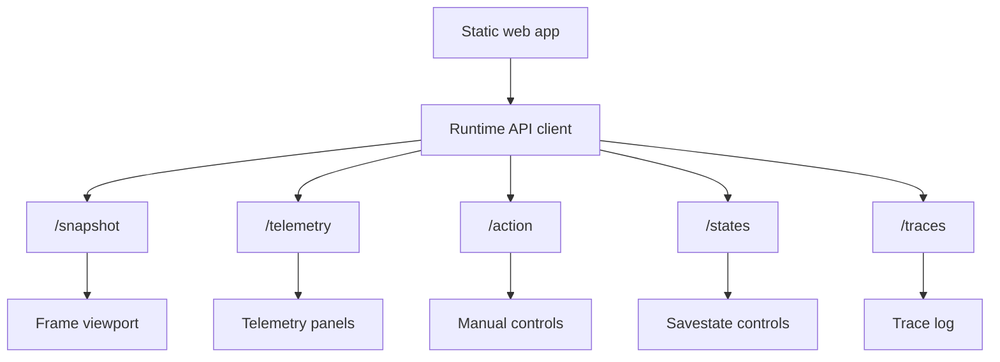

# Runtime Web Control Deck

## Goal

- Build the browser surface for manual runtime control and observation.
- Match the useful Pocodex workflow: live screen, controls, telemetry panels, traces, savestates, runtime logs, and compact agent context preview.
- Keep the UI utilitarian and reliable, not a marketing page.

## Starting Point

- Current behavior:
  - Plan 001 should provide basic static UI, `/snapshot`, `/telemetry`, `/action`, and traces.
  - Plan 002 should provide richer telemetry fields for display.
- Current files/docs to read first:
  - `.vault/plans/001-firered-runtime-spike-2026-06-04.md`
  - `.vault/plans/002-firered-telemetry-adapter-2026-06-04.md`
  - `/home/gilgames/Code/github-clones/Dimillian-Pocodex/tools/runtime/static/index.html`
  - `/home/gilgames/Code/github-clones/Dimillian-Pocodex/tools/runtime/static/app.js`
  - `/home/gilgames/Code/github-clones/Dimillian-Pocodex/tools/runtime/static/styles.css`

## Non-Goals and Boundaries

- Do not introduce a large frontend framework unless the project already needs one.
- Do not implement Codex autonomous action loops in this plan.
- Do not hide raw runtime failures behind polished UI states.
- Do not use decorative landing-page patterns; the first screen is the tool.

## Related Artifacts

- Research:
  - [x] `.vault/research/pocodex-pokefirered-runtime-2026-06-03.md`
- Decisions:
  - [x] `.vault/decisions/mgba-first-runtime-bridge-2026-06-04.md`
- Solutions:
  - [x] `.vault/solutions/runtime-web-control-deck-solution-2026-06-04.md`
- Encounters:
  - [x] `.vault/encounters/runtime-browser-tooling-2026-06-04.md`
- Visual companion:
  - [ ] Optional only if layout becomes complex.
- Goal run:
  - [x] `.vault/goals/goal-firered-runtime-2026-06-04/`

## Success Criteria

- [x] Browser shows a live or refreshable game frame without layout shifts.
- [x] Manual controls support directional buttons, A/B, Start/Select, hold/tap behavior, and keyboard shortcuts.
- [x] Telemetry panels show current mode, map, coordinates, party summary, bag summary, flags/vars summary, and raw debug details.
- [x] Savestate controls are runtime-owned and clearly separated from normal emulator saves.
- [x] Trace panel records actions, telemetry changes, runtime errors, and save/load events.
- [x] UI works at desktop and narrow/mobile-like widths with no overlapping text or controls.
- [x] Browser verification captures screenshots or documented observations for layout and interaction.

## Architecture Diagram



ASCII fallback:

```text
static UI -> runtime API -> frame / telemetry / action / states / traces
```

## ADR Summary

- Decision: Keep the web control deck static and runtime-focused until a framework is justified.
- Drivers:
  - Pocodex's utility comes from fast observation and control, not frontend complexity.
  - The runtime API is the important contract.
- Alternatives considered:
  - Full React app: deferred until static UI becomes limiting.
  - No UI until agent loop: rejected because manual observation is the debugging surface.
- Consequences:
  - UI tests can stay browser smoke and DOM-level at first.
  - Plan 004 can consume the same panels for agent context.
- Promote to `.vault/decisions/`: Only if a frontend stack decision becomes durable.

## Worktree Session

- Required: Yes after repo bootstrap.
- Recommended command: `bash ~/.agents/skills/core/git-worktree/scripts/worktree-manager.sh create runtime-web-control-deck --from <ref>`
- Expected worktree name: `runtime-web-control-deck`
- Branch plan: `feat/runtime-web-control-deck`
- Review note: Review UI in a browser against real runtime state before merging.

## Execution Steps

- [x] Step 1: Stabilize runtime API client.
  - ACTION: Create a small browser API client with explicit error states and polling cadence.
  - IMPLEMENT: Use typed JSDoc or structured modules if staying vanilla JS.
  - FILES: `tools/runtime/static/app.js`
  - MIRROR: Pocodex static app patterns.
  - GOTCHA: Avoid overlapping polling requests that flood the runtime.
  - VALIDATE: Browser smoke and JS unit tests if test runner exists.
  - EVIDENCE: Added `tools/runtime/static/api-client.js` as a small ES module for `/health`, `/snapshot`, `/telemetry`, `/traces`, and `/action`; app polling is single-flight and requests time out with explicit errors. `timeout 30s /tmp/pokemon-runtime-venv/bin/python -m pytest -q tools/runtime/tests/test_runtime_api_client_should_handle_endpoint_contracts.py tools/runtime/tests/test_static_deck_should_serve_index.py -vv` -> `3 passed, 1 skipped`; full runtime suite -> `40 passed, 8 skipped`.

- [x] Step 2: Build the screen and control surfaces.
  - ACTION: Render frame viewport, button controls, keyboard input, and current input state.
  - IMPLEMENT: Stable dimensions, accessible labels/tooltips, no layout shifts.
  - FILES: `tools/runtime/static/index.html`, `tools/runtime/static/styles.css`, `tools/runtime/static/app.js`
  - MIRROR: Pocodex web deck screenshot and local screenshot reference.
  - GOTCHA: Prevent repeated keydown from sending uncontrolled input storms.
  - VALIDATE: Manual keyboard and click smoke.
  - EVIDENCE: Added visible held-input state, accessible `aria-pressed` controls, pointer press/release handling for mouse/touch holds, keyboard keydown/keyup holds with repeat suppression, and serialized action requests. `timeout 30s /tmp/pokemon-runtime-venv/bin/python -m pytest -q tools/runtime/tests/test_control_surface_should_support_hold_inputs.py tools/runtime/tests/test_runtime_api_client_should_handle_endpoint_contracts.py -vv` -> `5 passed`; full runtime suite -> `42 passed, 8 skipped`.

- [x] Step 3: Build telemetry and trace panels.
  - ACTION: Render high-signal telemetry first, debug JSON second, and action/runtime traces.
  - IMPLEMENT: Keep raw values inspectable without drowning the operator.
  - FILES: `tools/runtime/static/app.js`, `tools/runtime/static/styles.css`
  - MIRROR: Pocodex telemetry panels.
  - GOTCHA: Show unknown/unavailable states honestly.
  - VALIDATE: Fixture API responses render stable states.
  - EVIDENCE: Added `tools/runtime/static/telemetry-format.js`, high-signal mode/map/player/camera/party/bag/flags-vars/symbol summaries, raw telemetry details, and clearer trace labels. `timeout 30s /tmp/pokemon-runtime-venv/bin/python -m pytest -q tools/runtime/tests/test_telemetry_panel_should_format_runtime_state.py tools/runtime/tests/test_runtime_api_client_should_handle_endpoint_contracts.py -vv` -> `5 passed`; full runtime suite -> `44 passed, 8 skipped`.

- [x] Step 4: Add savestate workflow.
  - ACTION: Expose runtime-owned state slots and save/load controls.
  - IMPLEMENT: Require explicit slot names or IDs; display timestamp and source ROM identity.
  - FILES: `tools/runtime/static/app.js`, runtime state endpoints as needed.
  - MIRROR: Pocodex `/states`, `/save_state`, `/load_state` concepts.
  - GOTCHA: Do not write to emulator default save locations if avoidable.
  - VALIDATE: Save/load smoke with dedicated runtime state directory.
  - EVIDENCE: Added `tools/runtime/state_slots.py`, contained slot validation, `/states`, `/states/{slot}/save`, `/states/{slot}/load`, fake and mGBA bridge save/load methods, and a UI state panel. `timeout 30s /tmp/pokemon-runtime-venv/bin/python -m pytest -q tools/runtime/tests/test_state_slot_should_stay_in_runtime_directory.py tools/runtime/tests/test_runtime_api_client_should_handle_endpoint_contracts.py tools/runtime/tests/test_telemetry_panel_should_format_runtime_state.py -vv` -> `8 passed`; full runtime suite -> `47 passed, 8 skipped`.

- [x] Step 5: Browser verification and accessibility pass.
  - ACTION: Verify desktop and narrow viewport layout, keyboard access, focus states, and text fit.
  - IMPLEMENT: Use Playwright or local browser tooling when available.
  - FILES: `tools/runtime/static/*`, `.vault/encounters/` if layout tooling fails in a reusable way.
  - MIRROR: project frontend instructions.
  - GOTCHA: Do not leave temporary screenshots or generated assets in tracked paths unless intentional.
  - VALIDATE: Browser screenshots or documented smoke results.
  - EVIDENCE: Served fake runtime at `http://127.0.0.1:18765/`; captured desktop screenshot `/tmp/pokemon-runtime-m3-desktop-fixed.png` and mobile screenshot `/tmp/pokemon-runtime-m3-mobile-fixed.png`; Playwright interaction smoke verified held A button state, save/load slot feedback, and action/state trace rendering. Final automated checks: `timeout 60s /tmp/pokemon-runtime-venv/bin/python -m pytest -q tools/runtime/tests` -> `50 passed, 5 skipped`; compile and `git diff --check` clean.

## Code Documentation Contract

- [x] Public API client functions document endpoint expectations.
- [x] Non-obvious polling, input cooldown, or state-slot rules are documented.
- [x] No comments that merely restate DOM updates.

## Testing Strategy (TDD)

### TDD Contract

- [ ] Red: add tests for API client behavior where practical.
- [ ] Green: implement the minimal rendering/control behavior.
- [ ] Refactor: improve layout and modules after behavior works.

### Test File Plan

- New tests to add:
  - `tools/runtime/tests/test_web_snapshot_endpoint_should_return_frame_payload.py`
  - `tools/runtime/tests/test_state_slot_should_stay_in_runtime_directory.py`
  - Optional JS tests if a frontend test runner is introduced.
- Existing tests to update:
  - API endpoint tests from plan 001.
- Naming convention notes:
  - Use `[condition]-should-[expected-behavior]` labels where possible.

### Coverage Layers

- [x] API endpoint tests
- [x] Browser interaction smoke
- [x] Responsive layout verification
- [x] Accessibility check for controls and focus order

## Execution Lanes

- Implementation lane: `implementer`
- Validation lane: `validator`
- Review lane: `reviewer`
- Security lane: `security`
- Pattern lane: `pattern-detector`
- Design lane: `design-iterator`
- Accessibility lane: `accessibility-auditor`

## Goal Run Overlay

- Goal run path: `.vault/goals/goal-firered-runtime-2026-06-04/`
- Role in goal run: Follow-up
- Milestone/task IDs:
  - `M3.T1` API client
  - `M3.T2` Screen and controls
  - `M3.T3` Telemetry and traces
  - `M3.T4` Savestates
  - `M3.T5` Browser and accessibility verification
- Dependencies:
  - `M3` depends on plans 001 and 002.
- Current state: complete
- Handoff source: `.vault/goals/goal-firered-runtime-2026-06-04/handoff.md`

## Verification Contract

- Primary commands:
  - `python -m pytest -q tools/runtime/tests`
  - Runtime server plus browser smoke against local URL
  - Playwright/browser screenshot verification when available
- Required proof of completion:
  - Layout smoke at desktop and narrow widths.
  - Manual controls demonstrably affect the dedicated emulator.
  - Trace and telemetry panels update after actions.
- Review gates:
  - validator pass
  - reviewer approve
  - accessibility-auditor pass for controls
  - design-iterator pass for layout defects

## Goal Contract

```text
Objective:
Complete plan 003 by turning the basic runtime UI into a Pocodex-style web control deck with live frame, controls, telemetry, traces, savestates, and browser verification.

Starting point:
Plans 001 and 002 should provide stable runtime APIs and telemetry. Active plan: `.vault/plans/003-runtime-web-control-deck-2026-06-04.md`.

Read first:
- `.vault/plans/001-firered-runtime-spike-2026-06-04.md`
- `.vault/plans/002-firered-telemetry-adapter-2026-06-04.md`
- `tools/runtime/static/*`

Constraints:
- Keep first screen as the actual tool, not a landing page.
- Do not add a frontend framework unless evidence shows static UI is insufficient.
- Do not implement autonomous agent behavior.

Iteration policy:
- Build controls and panels in small slices.
- Verify in browser after meaningful UI changes.
- Capture layout or browser-tool blockers as encounters.

Verification:
- `python -m pytest -q tools/runtime/tests`
- Manual browser smoke and responsive/accessibility checks.

Stop conditions:
- Success: success criteria pass with evidence.
- Ask user: frontend stack expansion or broad UI redesign.
- Blocker: browser/runtime integration cannot be verified locally.

Final evidence:
- Test output, browser verification summary, UI behavior summary, and updated goal progress.
```

## Durable Artifact Capture Rule

- Capture `.vault/decisions/runtime-web-control-deck-decision-2026-06-04.md` for durable frontend stack or UX choices.
- Capture `.vault/solutions/runtime-web-control-deck-solution-2026-06-04.md` for reusable polling/input/savestate UI patterns.
- Capture `.vault/encounters/runtime-web-control-deck-encounter-2026-06-04.md` for recurring browser/layout/runtime blockers.

## Risks and Mitigations

| Risk | Likelihood | Impact | Mitigation |
|------|------------|--------|------------|
| Polling overloads runtime or emulator bridge. | Medium | Medium | Use controlled cadence and pause on hidden tab/errors. |
| UI sends repeated uncontrolled inputs. | Medium | High | Add button whitelist, cooldowns, and trace every action. |
| Layout breaks on narrow viewport. | Medium | Medium | Use stable dimensions and browser verification. |

## Open Questions

- [x] Should savestate slots be named manually, numbered, or both? Answer: manually named slots first, validated as 1-32 letters, numbers, underscores, or dashes.

## Progress Log

- 2026-06-04: Plan created as web/UI follow-up to runtime and telemetry plans.
- 2026-06-04: Plan completed with static ES module UI, runtime-owned state slots, desktop/mobile screenshots, Playwright interaction smoke, and `50 passed, 5 skipped` runtime tests.
