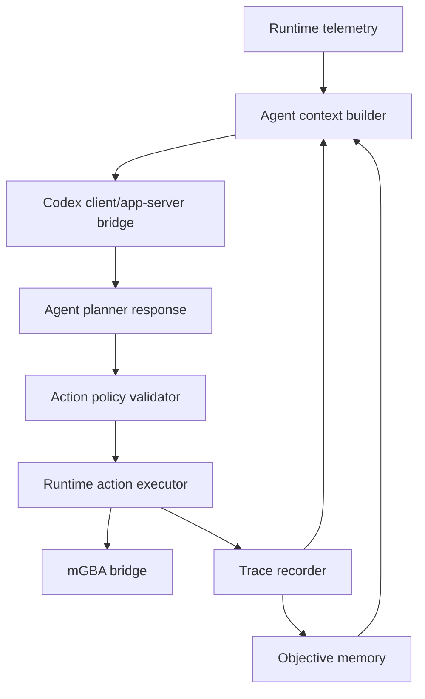

# Codex Agent Loop

## Goal

- Add a planner-safe Codex agent loop on top of the manual runtime.
- Provide compact `agent_context`, validated action tools, traces, objective memory, and an observe -> decide -> act -> verify loop.
- Prevent uncontrolled gameplay actions by constraining inputs, cadence, state checks, and stop conditions.

## Starting Point

- Current behavior:
  - Plans 001 through 003 should provide runtime API, telemetry, manual action execution, traces, savestates, and a web UI.
  - Pocodex already has a useful reference shape for `codex_client.py`, `agent_service.py`, `agent_context.py`, action executor, objective memory, and planner steps.
- Current files/docs to read first:
  - `.vault/plans/001-firered-runtime-spike-2026-06-04.md`
  - `.vault/plans/002-firered-telemetry-adapter-2026-06-04.md`
  - `.vault/plans/003-runtime-web-control-deck-2026-06-04.md`
  - `/home/gilgames/Code/github-clones/Dimillian-Pocodex/tools/runtime/codex_client.py`
  - `/home/gilgames/Code/github-clones/Dimillian-Pocodex/tools/runtime/agent_service.py`
  - `/home/gilgames/Code/github-clones/Dimillian-Pocodex/tools/runtime/agent_context.py`
  - `/home/gilgames/Code/github-clones/Dimillian-Pocodex/tools/runtime/action_executor.py`
  - `/home/gilgames/Code/github-clones/Dimillian-Pocodex/tools/runtime/objective_runner.py`
  - `/home/gilgames/Code/github-clones/Dimillian-Pocodex/tools/runtime/interaction_policy.py`

## Non-Goals and Boundaries

- Do not let an agent issue raw arbitrary emulator commands.
- Do not bypass action whitelist, input cooldowns, or trace recording.
- Do not require cloud credentials in committed config.
- Do not optimize for full game completion in this plan.
- Do not run long autonomous sessions without user-visible stop controls and savestates.

## Related Artifacts

- Research:
  - [x] `.vault/research/pocodex-pokefirered-runtime-2026-06-03.md`
- Decisions:
  - [x] `.vault/decisions/dedicated-runtime-emulator-instance-2026-06-03.md`
- Solutions:
  - [ ] `.vault/solutions/codex-agent-loop-solution-2026-06-04.md`
- Encounters:
  - [ ] `.vault/encounters/codex-agent-loop-encounter-2026-06-04.md`
- Visual companion:
  - [ ] Optional only if agent flow becomes hard to reason about.
- Goal run:
  - [x] `.vault/goals/goal-firered-runtime-2026-06-04/`

## Success Criteria

- [ ] `/agent_context` returns compact, high-signal state for model use without large raw dumps or private paths.
- [ ] Action policy exposes a small validated tool set such as tap, hold, wait, save_state, load_state, inspect, and stop.
- [ ] Agent loop records every proposed action, validation decision, execution result, and post-action telemetry delta.
- [ ] Objective runner can execute short bounded goals such as "open menu", "walk one tile", or "wait until field mode" using savestate-backed recovery.
- [ ] UI exposes agent state, current objective, last action, stop/pause controls, and logs.
- [ ] Tests cover action validation, blocked actions, context compaction, objective runner stop conditions, and trace recording.

## Architecture Diagram



ASCII fallback:

```text
telemetry -> agent_context -> Codex planner -> action policy -> runtime action -> trace -> context
```

## ADR Summary

- Decision: Agent control must be layered on top of validated runtime actions, not emulator primitives.
- Drivers:
  - Protect saves and runtime state.
  - Make action traces reviewable.
  - Keep failures recoverable with savestates.
- Alternatives considered:
  - Raw button access for the model: rejected as too hard to audit.
  - Agent loop before manual UI: rejected because manual controls are the debugging baseline.
- Consequences:
  - Every agent action needs validation, trace, and post-action verification.
  - Agent context must be compact and schema-driven.
- Promote to `.vault/decisions/`: Capture action-policy boundaries if implementation refines them.

## Worktree Session

- Required: Yes.
- Recommended command: `bash ~/.agents/skills/core/git-worktree/scripts/worktree-manager.sh create codex-agent-loop --from <ref>`
- Expected worktree name: `codex-agent-loop`
- Branch plan: `feat/codex-agent-loop`
- Review note: Run short bounded objectives only; do not leave an agent loop running after validation.

## Execution Steps

- [ ] Step 1: Define agent context schema.
  - ACTION: Build a compact model-facing context from telemetry, traces, action affordances, and objective state.
  - IMPLEMENT: Include unknown/unavailable fields explicitly; cap sizes.
  - FILES: `tools/runtime/agent_context.py`, `tools/runtime/state_models.py`
  - MIRROR: Pocodex `agent_context.py`
  - GOTCHA: Do not include local ROM paths, secrets, or large raw memory dumps.
  - VALIDATE: Context size and content tests.

- [ ] Step 2: Implement action policy.
  - ACTION: Define allowed actions, cooldowns, preconditions, and stop controls.
  - IMPLEMENT: Validate before execution and trace rejected actions too.
  - FILES: `tools/runtime/interaction_policy.py`, `tools/runtime/action_executor.py`
  - MIRROR: Pocodex interaction policy and action executor.
  - GOTCHA: Avoid direct arbitrary Lua/memory write exposure.
  - VALIDATE: Blocked/allowed action tests.

- [ ] Step 3: Add Codex client/app-server integration.
  - ACTION: Add a client layer that can call Codex app-server or local agent interface as configured.
  - IMPLEMENT: Keep credentials/config ignored; support disabled/no-agent mode.
  - FILES: `tools/runtime/codex_client.py`, `tools/runtime/agent_service.py`
  - MIRROR: Pocodex `codex_client.py`, `agent_service.py`
  - GOTCHA: Do not require agent credentials to run manual runtime.
  - VALIDATE: Fake client tests.

- [ ] Step 4: Implement bounded objective runner.
  - ACTION: Add observe -> decide -> act -> verify loop with step caps, state deltas, savestate recovery hooks, and stop conditions.
  - IMPLEMENT: Start with short objectives only.
  - FILES: `tools/runtime/objective_runner.py`, `tools/runtime/objective_memory.py`, `tools/runtime/objective_scoring.py`
  - MIRROR: Pocodex objective runner and memory.
  - GOTCHA: Avoid claiming progress from action count alone; verify against telemetry deltas.
  - VALIDATE: Fake runtime objective tests.

- [ ] Step 5: Expose agent endpoints and UI state.
  - ACTION: Add endpoints and web controls for agent context, planner step, routine/objective run, pause, stop, and logs.
  - IMPLEMENT: Keep endpoints disabled or guarded when no agent config exists.
  - FILES: `tools/runtime/server.py`, `tools/runtime/static/*`
  - MIRROR: Pocodex agent endpoints.
  - GOTCHA: Do not let UI start unbounded sessions by accident.
  - VALIDATE: Endpoint tests and manual short objective smoke.

## Code Documentation Contract

- [ ] Agent context schema documents size limits and privacy boundaries.
- [ ] Action policy documents safety invariants and cooldowns.
- [ ] Objective runner documents stop conditions and verification expectations.

## Testing Strategy (TDD)

### TDD Contract

- [ ] Red: tests for blocked actions, context size/privacy, fake planner loops, and stop conditions.
- [ ] Green: minimal implementation.
- [ ] Refactor: extract shared objective logic only after tests cover behavior.

### Test File Plan

- New tests to add:
  - `tools/runtime/tests/test_agent_context_should_omit_private_paths.py`
  - `tools/runtime/tests/test_blocked_agent_action_should_be_traced.py`
  - `tools/runtime/tests/test_objective_step_limit_should_stop_runner.py`
  - `tools/runtime/tests/test_objective_delta_missing_should_not_claim_success.py`
  - `tools/runtime/tests/test_agent_disabled_should_preserve_manual_runtime.py`
- Existing tests to update:
  - Action executor and trace tests from plans 001 and 003.
- Naming convention notes:
  - Use `[condition]-should-[expected-behavior]` labels where possible.

### Coverage Layers

- [x] Unit tests for policy/context/runner
- [x] Integration tests with fake runtime and fake client
- [ ] Manual short objective smoke with real runtime
- [ ] Security/privacy review for context and config

## Execution Lanes

- Implementation lane: `implementer`
- Validation lane: `validator`
- Review lane: `reviewer`
- Security lane: `security`
- Pattern lane: `pattern-detector`
- Design lane: `design-iterator` for UI state only
- Accessibility lane: `accessibility-auditor` for agent controls

## Goal Run Overlay

- Goal run path: `.vault/goals/goal-firered-runtime-2026-06-04/`
- Role in goal run: Follow-up
- Milestone/task IDs:
  - `M4.T1` Agent context
  - `M4.T2` Action policy
  - `M4.T3` Codex client
  - `M4.T4` Objective runner
  - `M4.T5` Agent endpoints/UI
- Dependencies:
  - `M4` depends on plans 001 through 003.
- Current state: planned
- Handoff source: `.vault/goals/goal-firered-runtime-2026-06-04/handoff.md`

## Verification Contract

- Primary commands:
  - `python -m pytest -q tools/runtime/tests`
  - Manual bounded agent objective smoke against dedicated runtime
- Required proof of completion:
  - Agent context sample without private paths.
  - Trace showing proposed, validated, executed, and verified action.
  - Short objective run stops by success, step cap, or explicit stop.
- Review gates:
  - validator pass
  - reviewer approve
  - security pass required
  - pattern-detector pass for policy boundaries

## Goal Contract

```text
Objective:
Complete plan 004 by adding a planner-safe Codex agent loop with compact `agent_context`, validated actions, traces, objective memory, bounded runner, and UI/endpoints for pause/stop/logs.

Starting point:
Plans 001 through 003 should provide manual runtime control, telemetry, traces, and web UI. Active plan: `.vault/plans/004-codex-agent-loop-2026-06-04.md`.

Read first:
- `.vault/plans/001-firered-runtime-spike-2026-06-04.md`
- `.vault/plans/002-firered-telemetry-adapter-2026-06-04.md`
- `.vault/plans/003-runtime-web-control-deck-2026-06-04.md`
- Pocodex agent/runtime reference files listed in this plan.

Constraints:
- No raw arbitrary emulator commands for agents.
- No committed credentials.
- No unbounded autonomous sessions.

Iteration policy:
- Test policy and runner behavior first with fakes.
- Run only short bounded objectives on real runtime.
- Capture security or policy decisions durably.

Verification:
- `python -m pytest -q tools/runtime/tests`
- Manual short objective smoke with trace evidence.

Stop conditions:
- Success: success criteria pass.
- Ask user: agent credential setup, unbounded run, or objective scope expansion.
- Blocker: app-server/client integration unavailable after two focused attempts.

Final evidence:
- Test output, agent context sample summary, trace summary, and updated goal progress.
```

## Durable Artifact Capture Rule

- Capture `.vault/decisions/codex-agent-loop-decision-2026-06-04.md` for durable action-policy or client boundaries.
- Capture `.vault/solutions/codex-agent-loop-solution-2026-06-04.md` for reusable objective-runner or trace patterns.
- Capture `.vault/encounters/codex-agent-loop-encounter-2026-06-04.md` for recurring agent/client failures.

## Risks and Mitigations

| Risk | Likelihood | Impact | Mitigation |
|------|------------|--------|------------|
| Agent takes uncontrolled repeated actions. | Medium | High | Enforce action whitelist, cooldowns, step caps, and stop controls. |
| Agent context leaks private paths or local config. | Low | High | Add privacy tests and security review. |
| Objective runner claims success without telemetry evidence. | Medium | High | Require post-action verification and scoring tests. |

## Open Questions

- [ ] Which Codex client surface should be used first in this environment: Pocodex-style `codex app-server` or a simpler local disabled/fake-first path?

## Progress Log

- 2026-06-04: Plan created as agent-loop follow-up after manual runtime stabilization.
