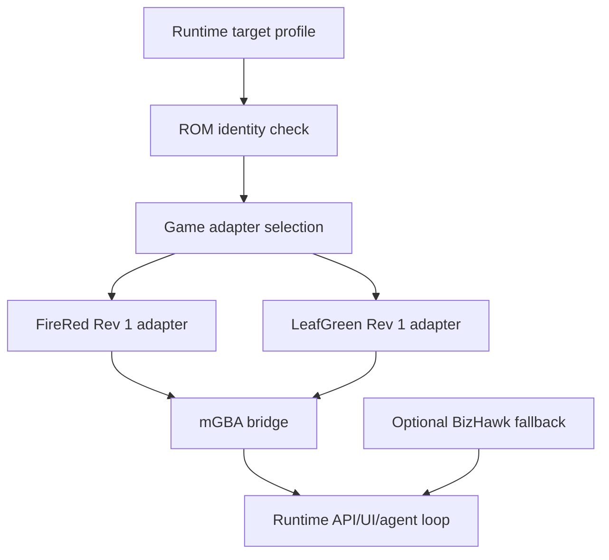

# LeafGreen Support And Runtime Hardening

## Goal

- Extend the runtime from FireRed Rev 1 to LeafGreen Rev 1.
- Harden configuration, packaging, fallback emulator strategy, docs, tests, and safety checks after the FireRed runtime is stable.
- Prepare the project for repeated local use without relying on fragile one-off setup.

## Starting Point

- Current behavior:
  - Plans 001 through 004 should provide a working FireRed Rev 1 runtime, telemetry adapter, web deck, and agent loop.
  - The user's LeafGreen Rev 1 ROM hash has already been verified in the research note.
- Current files/docs to read first:
  - `.vault/plans/001-firered-runtime-spike-2026-06-04.md`
  - `.vault/plans/002-firered-telemetry-adapter-2026-06-04.md`
  - `.vault/plans/003-runtime-web-control-deck-2026-06-04.md`
  - `.vault/plans/004-codex-agent-loop-2026-06-04.md`
  - `.vault/research/pocodex-pokefirered-runtime-2026-06-03.md`
  - `README.md`
  - `INSTALL.md`
  - `Makefile`
  - `leafgreen_rev1.sha1`

## Non-Goals and Boundaries

- Do not support every `pokefirered` revision in this plan.
- Do not support Emerald/Ruby/Sapphire/Crystal/Gold/Silver in this plan.
- Do not package or distribute ROMs, BIOS files, emulator binaries, or saves.
- Do not make BizHawk primary unless mGBA has proven insufficient and an encounter documents the reason.

## Related Artifacts

- Research:
  - [x] `.vault/research/pocodex-pokefirered-runtime-2026-06-03.md`
- Decisions:
  - [x] `.vault/decisions/mgba-first-runtime-bridge-2026-06-04.md`
  - [x] `.vault/decisions/target-profile-hash-verification-2026-06-04.md`
- Solutions:
  - [ ] `.vault/solutions/leafgreen-support-and-hardening-solution-2026-06-04.md`
- Encounters:
  - [ ] `.vault/encounters/leafgreen-support-and-hardening-encounter-2026-06-04.md`
- Visual companion:
  - [ ] Not needed initially.
- Goal run:
  - [x] `.vault/goals/goal-firered-runtime-2026-06-04/`

## Success Criteria

- [x] Runtime config supports FireRed Rev 1 and LeafGreen Rev 1 target profiles.
- [x] ROM identity checks reject mismatched files with explicit errors.
- [ ] Symbol/telemetry adapter handles LeafGreen Rev 1 differences or clearly documents shared behavior.
- [ ] Smoke tests launch both configured targets and verify health/snapshot/action/basic telemetry.
- [ ] Runtime directories for states, traces, logs, and screenshots are isolated by target profile.
- [ ] Setup docs explain Windows/WSL, mGBA path config, ROM path config, build/symbol expectations, and safety boundaries.
- [ ] If BizHawk fallback was needed, the fallback decision and adapter notes are captured durably.

## Architecture Diagram



ASCII fallback:

```text
target profile -> ROM identity -> game adapter -> mGBA bridge -> runtime API/UI/agent
                                      optional BizHawk fallback
```

## ADR Summary

- Decision: Add LeafGreen as a target profile after FireRed stabilizes, not during the first spike.
- Drivers:
  - FireRed and LeafGreen Rev 1 ROMs are both owned and hash-verified.
  - Target profiles keep differences explicit.
  - Hardening should happen after real runtime evidence exists.
- Alternatives considered:
  - Support both games from plan 001: rejected as premature.
  - Generalize to all Gen 3 Pokemon games: rejected as beyond current scope.
- Consequences:
  - Config, state directories, and telemetry schema need target identity.
  - Runtime docs must be explicit about local-only ROMs and emulator setup.
- Promote to `.vault/decisions/`: Capture if target profile design or BizHawk fallback becomes durable.

## Worktree Session

- Required: Yes.
- Recommended command: `bash ~/.agents/skills/core/git-worktree/scripts/worktree-manager.sh create leafgreen-support-hardening --from <ref>`
- Expected worktree name: `leafgreen-support-hardening`
- Branch plan: `feat/leafgreen-support-hardening`
- Review note: Review docs and ignore rules before any publish or commit.

## Execution Steps

- [x] Step 1: Introduce target profiles.
  - ACTION: Add target profile config for FireRed Rev 1 and LeafGreen Rev 1.
  - IMPLEMENT: Include expected SHA-1, display name, symbol file, game adapter, and runtime directories.
  - FILES: `tools/runtime/config.py`, `tools/runtime/runtime.example.toml`, `tools/runtime/target_profiles.py`
  - MIRROR: `pret/pokefirered` target names and SHA files.
  - GOTCHA: Reject mismatched ROMs explicitly.
  - VALIDATE: `12 passed` focused profile/config/factory tests; `71 passed, 10 skipped` full runtime tests.

- [ ] Step 2: Add LeafGreen adapter path.
  - ACTION: Reuse FireRed adapter where source-compatible and isolate differences where needed.
  - IMPLEMENT: Avoid copy/paste until differences are proven; use shared Gen 3 helpers when legitimate.
  - FILES: `tools/runtime/games/leafgreen/`, `tools/runtime/games/gen3/`
  - MIRROR: FireRed adapter from plan 002.
  - GOTCHA: Do not assume every symbol/address is identical without evidence.
  - VALIDATE: LeafGreen fixture tests and runtime smoke.

- [ ] Step 3: Harden runtime storage and safety.
  - ACTION: Separate state, trace, log, screenshot, and cache paths by target profile.
  - IMPLEMENT: Enforce path containment under runtime-owned ignored directories.
  - FILES: `tools/runtime/storage.py`, `.gitignore`, docs
  - MIRROR: plan 003 savestate behavior.
  - GOTCHA: Path traversal and accidental writes outside runtime dirs.
  - VALIDATE: Path containment tests.

- [ ] Step 4: Add fallback bridge evaluation.
  - ACTION: Evaluate whether mGBA remains sufficient; only implement BizHawk if plan 001 or later encounters justify it.
  - IMPLEMENT: Keep bridge interface unchanged.
  - FILES: `tools/runtime/emulators/base.py`, optional `tools/runtime/emulators/bizhawk_bridge.py`
  - MIRROR: mGBA adapter contract.
  - GOTCHA: Do not add BizHawk complexity without evidence.
  - VALIDATE: Adapter contract tests.

- [ ] Step 5: Write setup and operating docs.
  - ACTION: Document Windows/WSL setup, mGBA config, ROM config, safety, tests, and troubleshooting.
  - IMPLEMENT: Include no ROM download instructions.
  - FILES: `tools/runtime/README.md`, top-level `README.md` additions
  - MIRROR: Pocodex runtime docs and `pret/pokefirered` install docs.
  - GOTCHA: Keep legal/ownership boundaries clear.
  - VALIDATE: Fresh-read doc review.

## Code Documentation Contract

- [x] Target profile schema documents required fields and identity checks.
- [ ] Storage helpers document path containment invariants.
- [ ] LeafGreen differences document source evidence.

## Testing Strategy (TDD)

### TDD Contract

- [ ] Red: write profile/hash/storage tests before target-profile implementation.
- [ ] Green: implement minimal target support.
- [ ] Refactor: extract shared Gen 3 helpers after FireRed/LeafGreen overlap is proven.

### Test File Plan

- New tests to add:
  - `tools/runtime/tests/test_wrong_rom_hash_should_fail_target_profile.py`
  - `tools/runtime/tests/test_leafgreen_profile_should_select_leafgreen_adapter.py`
  - `tools/runtime/tests/test_runtime_storage_should_stay_under_target_directory.py`
  - `tools/runtime/tests/test_adapter_contract_should_support_configured_targets.py`
- Existing tests to update:
  - Config, telemetry, and API smoke tests from plans 001 and 002.
- Naming convention notes:
  - Use `[condition]-should-[expected-behavior]` labels where possible.

### Coverage Layers

- [x] Unit tests for config/profile/storage
- [x] Integration smoke for both target profiles
- [ ] Optional fallback bridge contract tests if BizHawk is implemented
- [ ] Documentation review

## Execution Lanes

- Implementation lane: `implementer`
- Validation lane: `validator`
- Review lane: `reviewer`
- Security lane: `security`
- Pattern lane: `pattern-detector`
- Design lane: not applicable unless UI profile switcher changes
- Accessibility lane: not applicable unless UI profile switcher changes

## Goal Run Overlay

- Goal run path: `.vault/goals/goal-firered-runtime-2026-06-04/`
- Role in goal run: Follow-up / hardening
- Milestone/task IDs:
  - `M5.T1` Target profiles
  - `M5.T2` LeafGreen adapter
  - `M5.T3` Storage hardening
  - `M5.T4` Fallback bridge evaluation
  - `M5.T5` Setup docs
- Dependencies:
  - `M5` depends on plans 001 through 004.
- Current state: M5.T1 complete; M5.T2 ready
- Handoff source: `.vault/goals/goal-firered-runtime-2026-06-04/handoff.md`

## Verification Contract

- Primary commands:
  - `python -m pytest -q tools/runtime/tests`
  - Manual FireRed and LeafGreen runtime smoke checks
- Required proof of completion:
  - Hash/profile tests.
  - FireRed and LeafGreen smoke summaries.
  - Documentation review.
  - Security check confirming ROMs/saves/local config are ignored.
- Review gates:
  - validator pass
  - reviewer approve
  - security pass required
  - pattern-detector pass for profile/adapter design

## Goal Contract

```text
Objective:
Complete plan 005 by adding LeafGreen Rev 1 target support and hardening runtime profiles, storage, docs, tests, and fallback bridge decisions after FireRed stabilizes.

Starting point:
Plans 001 through 004 should provide a working FireRed runtime, UI, telemetry, and agent loop. Active plan: `.vault/plans/005-leafgreen-support-and-hardening-2026-06-04.md`.

Read first:
- `.vault/plans/001-firered-runtime-spike-2026-06-04.md`
- `.vault/plans/002-firered-telemetry-adapter-2026-06-04.md`
- `.vault/plans/003-runtime-web-control-deck-2026-06-04.md`
- `.vault/plans/004-codex-agent-loop-2026-06-04.md`
- `.vault/research/pocodex-pokefirered-runtime-2026-06-03.md`

Constraints:
- Do not support unrelated games or revisions.
- Do not package or distribute ROMs/saves/emulator binaries.
- Keep BizHawk fallback evidence-based.

Iteration policy:
- Test profile/hash/storage behavior first.
- Smoke FireRed before LeafGreen after shared changes.
- Capture fallback or target-profile decisions durably.

Verification:
- `python -m pytest -q tools/runtime/tests`
- Manual FireRed and LeafGreen runtime smoke checks.

Stop conditions:
- Success: success criteria pass.
- Ask user: adding more games/revisions or packaging decisions.
- Blocker: LeafGreen symbol/telemetry divergence requires redesign.

Final evidence:
- Test output, dual-target smoke summary, docs summary, and updated goal progress.
```

## Durable Artifact Capture Rule

- Capture `.vault/decisions/leafgreen-support-and-hardening-decision-2026-06-04.md` for durable target-profile or fallback choices.
- Capture `.vault/solutions/leafgreen-support-and-hardening-solution-2026-06-04.md` for reusable profile/storage patterns.
- Capture `.vault/encounters/leafgreen-support-and-hardening-encounter-2026-06-04.md` for recurring target divergence or setup blockers.

## Risks and Mitigations

| Risk | Likelihood | Impact | Mitigation |
|------|------------|--------|------------|
| FireRed and LeafGreen memory/symbol differences are larger than expected. | Medium | Medium | Keep target profiles explicit and add fixture tests per target. |
| Hardening expands into broad packaging work. | Medium | Medium | Stop at local setup docs and runtime safety unless user approves packaging. |
| Runtime state paths mix targets. | Low | High | Enforce target-scoped directories and path containment tests. |

## Open Questions

- [ ] Should target switching be runtime-start-only or available through the web UI after both targets work?

## Progress Log

- 2026-06-04: Plan created as post-FireRed hardening and LeafGreen support follow-up.
- 2026-06-04: M5.T1 complete. Added explicit FireRed Rev 1 and LeafGreen Rev 1 target profiles, default SHA-1 verification, visible mismatch metadata under explicit `verify_hash = false`, and profile/config/factory tests.
