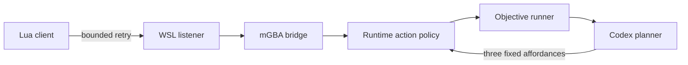

# Runtime Reconnect And Autonomous Smoke

## Goal

Prove the current FireRed runtime can launch on this Windows/WSL machine and
perform a short, policy-bounded Codex-controlled input sequence. Harden the two
runtime behaviors that invalidated a truthful smoke: one-shot Lua-client startup
and frame-only objective success.

## Starting Point

- The completed June runtime plans documented a working mGBA reverse socket, but
  a fresh July launch timed out after the Lua script made one failed connection.
- Visible mGBA advances while a planner deliberates, so a frame threshold could
  pass before multiple agent decisions occurred.
- Read first: `tools/runtime/emulators/mgba_bridge.lua`,
  `tools/runtime/emulators/mgba_bridge.py`, `tools/runtime/objective_runner.py`,
  `tools/runtime/objective_scoring.py`, and
  `.vault/solutions/mgba-wsl-reverse-socket-2026-06-04.md`.

## Non-Goals And Boundaries

- Do not change ROMs, saves, emulator binaries, or the default disabled local
  agent configuration.
- Do not claim semantic in-game progress without generated symbols or direct
  state evidence.
- The live smoke is capped at three advertised inputs and runs from a
  runtime-owned quick checkpoint.

## Success Criteria

- [x] Lua-client mGBA startup retries a transient WSL loopback failure without
  retrying indefinitely.
- [x] An objective can explicitly require a number of executed planner actions.
- [x] Focused regressions and the full runtime suite pass.
- [x] A real FireRed smoke records three GPT-5.6-Luna planner-selected,
  policy-validated inputs against mGBA.

## Architecture Diagram



## ADR Summary

- Decision: retry the Lua-client connection from an mGBA frame callback with
  finite attempt and frame bounds; add an explicit action-count success metric.
- Alternatives: single startup connection and frame-only success checks were
  rejected because both produced false-negative/false-positive smoke evidence.
- Consequence: a live smoke can prove executed input count, while semantic game
  state remains deliberately unclaimed until symbol-backed telemetry exists.

## Execution And Verification

- [x] Add bounded Lua retry and extend the Python listener timeout.
- [x] Add `agent_steps_at_least` scoring and behavior-first regression tests.
- [x] Run `/tmp/pokemon-runtime-venv/bin/python -m pytest -q tools/runtime/tests`
  -> `89 passed in 8.82s`.
- [x] Run compile and diff checks.
- [x] Run real mGBA FireRed smoke with GPT-5.6-Luna at low reasoning effort:
  `tap_a`, `tap_start`, `tap_up`; each was proposed, validated, and executed.

## Goal Contract

```text
Objective: Continue FireRed runtime work from .vault/plans/006-runtime-reconnect-and-autonomy-smoke-2026-07-09.md. Preserve the bounded mGBA bridge and action policy. Verify any new play claim with live traces plus semantic telemetry; do not infer game progress from elapsed frames alone. Stop for ROM/config changes, destructive operations, or any request to broaden targets.
```

## Durable Artifact Capture Rule

Capture bridge and objective-evaluation regressions as reusable solutions or
encounters, including live-smoke evidence and any remaining telemetry limits.

## Risks And Open Questions

- Missing generated symbols still prevent map/mode/player confirmation.
- The three-input smoke proves runtime control, not that the title flow or a
  particular game location changed.

## Progress Log

- 2026-07-09: Completed implementation, focused regressions, full suite, and
  real three-input autonomous smoke.
