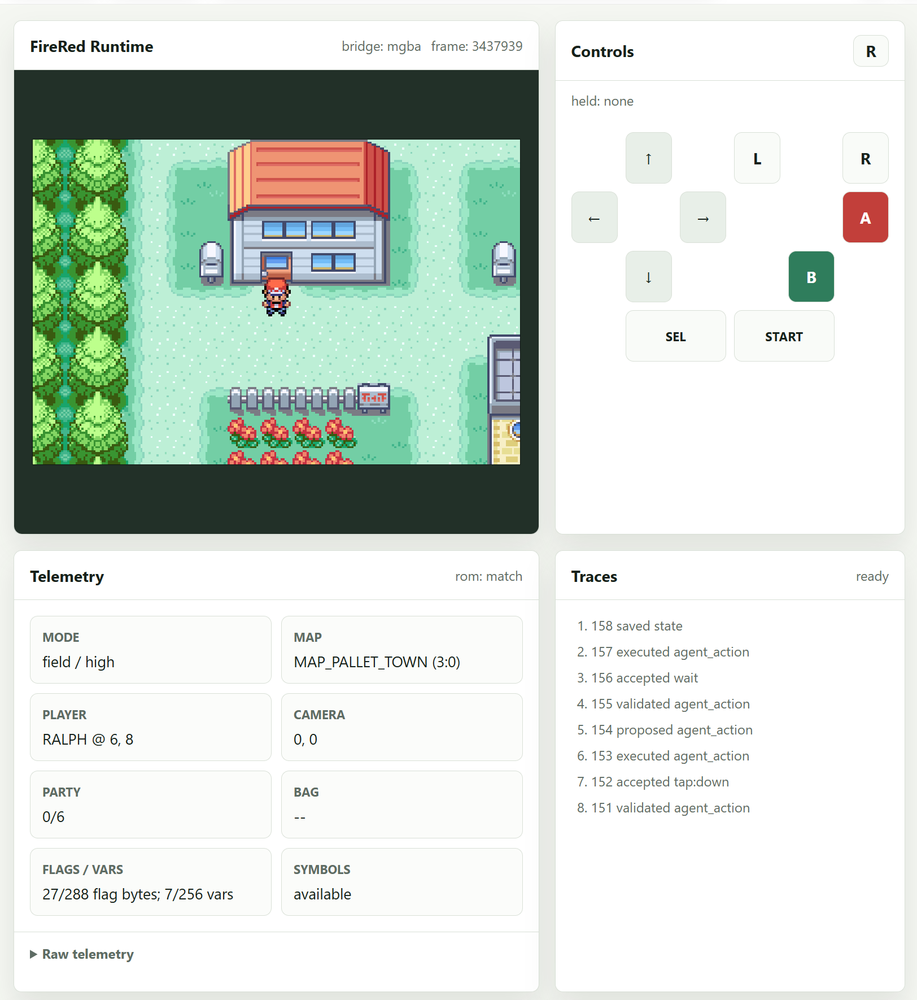

# Pokémon FireRed & LeafGreen: disassembly and agent runtime

Rebuild the games from source, inspect their live state, and let a model choose actions in a real emulator. This project extends [pret/pokefirered](https://github.com/pret/pokefirered) with a local mGBA runtime, browser controls, structured telemetry, checkpoints, and bounded autonomous play.



*The control deck after the house-exit objective: Pallet Town, position `(6,8)`, with high-confidence field telemetry.*

## How it works

1. **Build and identify.** Matching build symbols connect game-memory addresses to source names. The runtime checks the owned ROM against its expected hash.
2. **Observe.** A dedicated mGBA instance exposes a screenshot and game state through a Lua bridge. The browser shows controls, map, position, party, and traces.
3. **Act.** The planner receives structured state and a screenshot, then chooses one advertised action with a fixed input bound.
4. **Verify.** The runtime checks explicit map, coordinate, and mode goals. Checkpoints support recovery; traces retain the decisions and outcomes.

The original model options are **GPT-5.6 Luna** and **GPT-5.6 Sol**, selected through local configuration.

## Verified scope

GPT-5.6 Luna at xhigh navigated from the upstairs bedroom, down the stairs, and outside into Pallet Town in **22 decisions across two bounded runs**. Normal-save fingerprints remained unchanged. FireRed and LeafGreen Rev 1 also passed input and checkpoint checks. Battles, full story progression, and LeafGreen autonomous routes still need verification.

## Get started

Follow [INSTALL.md](INSTALL.md) for the source build, then the [runtime guide](tools/runtime/README.md) for dependencies, matching symbols, and an ignored local configuration. Start the configured runtime from the repository root:

```sh
.venv/bin/python -m tools.runtime.server \
  --config tools/runtime/runtime.local.toml \
  --host 127.0.0.1 --port 8795
```

Open `http://127.0.0.1:8795/`. Use the [verification recipe](.agents/skills/verify-pokemon-runtime/SKILL.md) to repeat checks and the [roadmap](docs/PLAN.md) for current status.

## Repository layout

| Path | Purpose |
|---|---|
| `src/`, `asm/`, `data/` | Game source and assets |
| `make/` | Build rules, linker inputs, and expected ROM checksums |
| `scripts/` | Build and inspection helpers |
| `tools/runtime/` | Emulator bridge, telemetry, planner, and web deck |
| `docs/` | Roadmap, guides, and visual feature map |

Use your own ROMs. ROMs, normal saves, emulator binaries, credentials, and machine-specific configuration stay outside Git.
